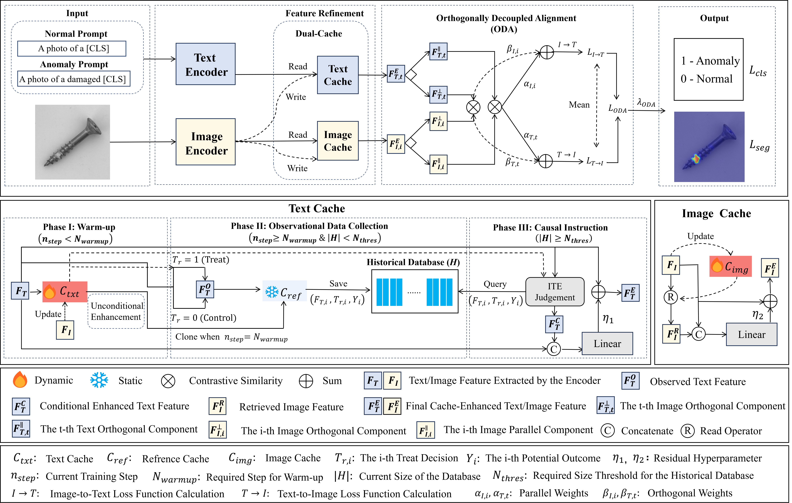
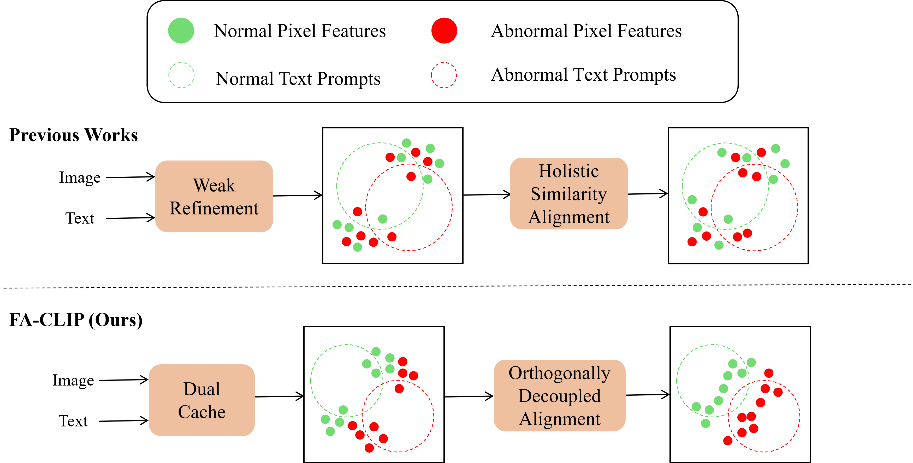
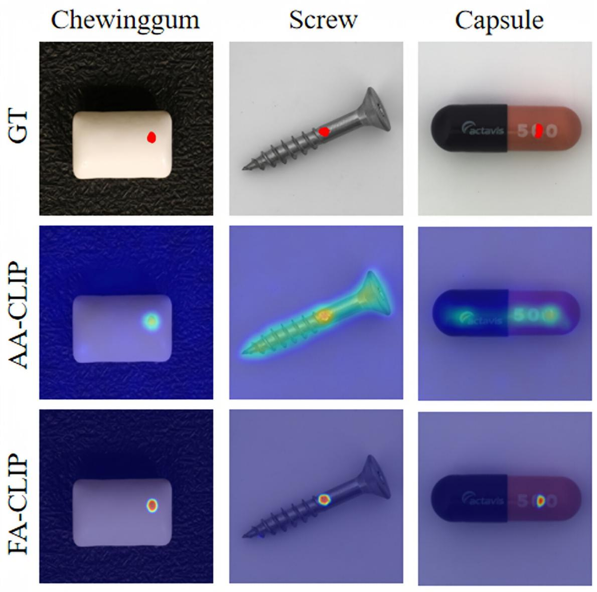
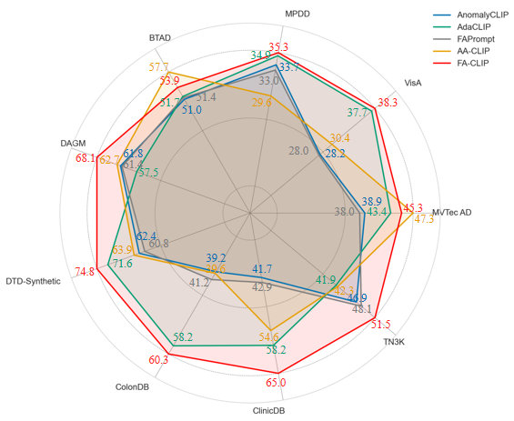

# FA-CLIP: Fine-Grained Aligned CLIP for Zero-Shot Anomaly Detection

---

### FA-CLIP Framework 

  

---

### Motivation

  

---

### Fine-Grained Capability

  <table>
    <tr>
      <td align="center">
         
        (a) Qualitative Visualization
      </td>
      <td align="center">
         
        (b) Quantitative Comparison
      </td>
    </tr>
  </table>

🚧 Codes will be available sooner.
